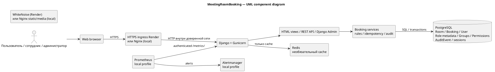
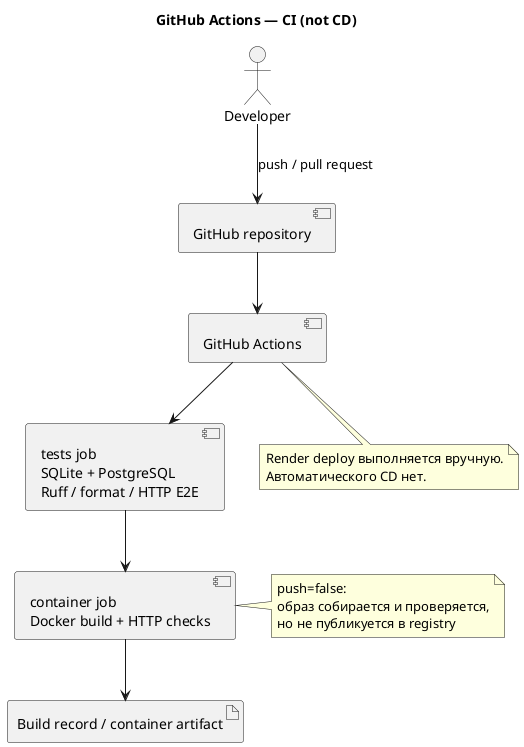

# Архитектура MeetingRoomBooking

Документ описывает фактическую архитектуру двух профилей. Локальный Docker Compose используется для интеграционных проверок и демонстрации инфраструктуры; Render использует отдельный entrypoint и не поднимает локальный Nginx или Prometheus автоматически.

## 1. UML component diagram — логическая архитектура



## 2. UML deployment diagram — локальный Docker Compose

```plantuml
@startuml
title Local / test deployment
node "Developer workstation / Docker host" {
  node "Docker Compose project" {
    node "proxy container" { component "Nginx\nHTTP / HTTPS / static / media" as nginx }
    node "app container" { component "Gunicorn + Django" as django }
    database "db container\nPostgreSQL" as postgres
    node "redis container" { component "Redis cache" as redis }
    node "monitoring profile" {
      component "Prometheus" as prometheus
      component "Alertmanager" as alertmanager
    }
  }
}
actor "Browser" as browser
browser --> nginx
nginx --> django
django --> postgres
django --> redis
prometheus --> django : /metrics/ with bearer token
prometheus --> alertmanager
@enduml
```

Порты мониторинга привязаны к loopback. PostgreSQL и Redis не публикуют host-порты в стандартном профиле. Тестовые проекты и volumes изолированы от пользовательской установки.

## 3. UML deployment diagram — Render + Neon

```plantuml
@startuml
title Cloud deployment — Render + Neon
actor "Browser" as browser
node "Render" {
  component "Managed HTTPS ingress" as ingress
  node "Web service / Dockerfile.render" {
    component "Gunicorn + Django" as cloudapp
    component "WhiteNoise static files" as whitenoise
  }
}
cloud "Neon PostgreSQL" { database "PostgreSQL branch" as neon }
cloud "Upstash Redis (optional)" as upstash
browser --> ingress : HTTPS
ingress --> cloudapp
cloudapp --> neon : verified TLS / SQL
cloudapp --> upstash : optional TLS cache
cloudapp --> whitenoise
@enduml
```

В Render TLS завершается на управляемом ingress, приложение обслуживает Gunicorn, а static раздаёт WhiteNoise. Redis необязателен и не хранит бронирования, историю, permissions или ключи идемпотентности. Локальные Prometheus и Alertmanager не считаются развёрнутыми в Render.

## 4. CI pipeline



## 5. Границы и архитектурные решения

- PostgreSQL — единственный источник истины для бронирований, revision, idempotency, AuditEvent и сессий.
- Redis используется только для некритичного кэша; его отказ не должен терять бронирования.
- В локальном профиле Nginx обслуживает reverse proxy и static/media; в Render эту роль выполняют ingress и WhiteNoise.
- GitHub Actions проверяет код и собирает контейнерный образ. Workflow не публикует образ в registry и не развёртывает приложение в Render.
- Фоновой очереди задач (Celery/RQ) в проекте нет; обработка пользовательских операций синхронная.
- Prometheus, Alertmanager и Grafana dashboard доступны в локальном демонстрационном профиле. Метрики HTTP и PostgreSQL connections проверяются в CI; внешняя email/webhook-доставка alert оператору не настроена.
