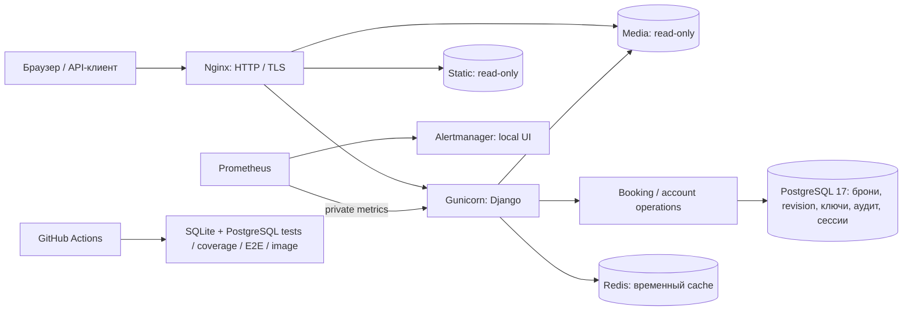

# Готовность к сдаче — 20 ноября 2026

Текущая контрольная точка: `0cb34a0` (`main`, 20.11.2026). В `main` включены
исправление адаптивности шапки (`81900e4`) и числовая сортировка каталога
(`0cb34a0`). GitHub Actions run №21 для `0cb34a0` завершился успешно: jobs
`tests` и `container`. Публичный сервис Render развёрнут вручную; владелец
подтвердил доступ к сайту, вход, исправленную шапку и порядок карточек каталога.
Автоматический CD не настроен. Ниже отдельно указаны измеренные результаты,
ручные подтверждения, планы и эксплуатационные ограничения.

## Что уже было и что завершено

До этапа: работающие бронирования, Permissions/Groups, VIP, revision,
идемпотентность, AuditEvent, защита истории/миграций, безопасный профиль и CSV;
358 тестов. Во время инфраструктурной работы: Docker, Gunicorn, Nginx, Redis,
Compose-профили, healthcheck, CI workflow, настройки окружения, 15 новых тестов.
Для сдачи добавлены явные CSV room/date-фильтры, OpenAPI/Swagger, метрики,
Prometheus/Alertmanager, ещё 7 тестов, HTTP E2E, покрытие и нагрузочный сценарий.
В отдельном исправлении каталога 20.11 добавлены ещё 8 регрессионных тестов
порядка, поиска и фильтров. Бизнес-операции, permissions, группы, миграции и
прежние тесты не переписывались.

## Проверенные результаты

| Проверка | Факт |
|---|---|
| Полный набор SQLite в памяти (регрессионный прогон 20.11) | **388 успешно, 72 пропущено**, ошибок нет; пропуски относятся к PostgreSQL-специфичным проверкам |
| Полный набор PostgreSQL 18.7 в изолированном Docker-проекте | **455 успешно, 5 пропущено**, ошибок нет |
| Проверки пустой PostgreSQL-базы | **5/5 успешно**; выполнены отдельно до подготовки схемы HTTP-стенда |
| Регрессионные HTTP E2E | **8/8 успешно** |
| Различные автоматические тесты | **468 различных тестов** успешно выполнены хотя бы в одном подходящем окружении; это число уникальных тестов, а не сумма всех запусков |
| Критическая логика, statements + branches | **91,81%** по `scripts/check_coverage.py` в отдельном регрессионном аудите 20.11 |
| Весь измеренный код | **90,31%** по сохранённому `reports/coverage-summary.json`; это общий показатель и он не заменяет процент критических модулей |
| GitHub Actions | **Run №21 — success**, push в `main`, commit `0cb34a0`; оба jobs `tests` и `container` завершились успешно. CI использует PostgreSQL 17.12; локальный регрессионный аудит выше отдельно выполнялся на PostgreSQL 18.7 |
| Django / статические проверки | Django check, Ruff, проверка форматирования, `pip check`, `git diff --check` прошли; `makemigrations --check --dry-run` сообщил `No changes detected` |
| Docker / HTTP | Сборка контейнера успешна; в CI прошли запуск изолированных зависимостей, миграция новой CI-базы, readiness, восстановление после отказа зависимостей, HTTP E2E и PostgreSQL-набор внутри образа |
| Render | Публичный сайт развёрнут вручную. Владелец подтвердил доступ к сайту и вход, а также визуальную работу исправленной шапки и числового порядка карточек каталога. Полные сценарии создания/отмены бронирования и VIP-согласования на публичном Render этим подтверждением не покрыты |
| Backup/restore | В отдельной тестовой БД `stage563_restore` восстановлены 3 брони, 6 событий и 3 ключа; trigger и exclusion constraint присутствуют. Это тестовое восстановление в новую БД, не проверка аварийного восстановления production |
| Мониторинг | Prometheus scrape — up; тестовое предупреждение `RedisUnavailable` получено Alertmanager; внешние уведомления оператору не настроены |

Отчёты измерений: `reports/coverage-summary.json`, `reports/load-100.json`,
`reports/load-200.json`, `reports/monitoring.json`. Покрытие измерено полным
PostgreSQL-набором; `scripts/check_coverage.py` отдельно считает statements +
branches только для явно перечисленных критических модулей. CI run №21 использует
PostgreSQL 17.12, а отдельный регрессионный аудит 20.11 — PostgreSQL 18.7; это
разные окружения и результаты не следует смешивать.

Нагрузочные JSON содержат короткие read-only прогоны каталога и API, а не смешанную
нагрузку с записью бронирований. Monitoring JSON подтверждает локальный тестовый
alert, но не доставку внешнему оператору. Результат backup/restore получен на
изолированной тестовой БД, а не на Neon или Render.

Предыдущая host-попытка PostgreSQL-прогона выявила мутацию словаря settings при
обнаружении container settings; исправлено deepcopy и добавлена регрессия.
После этого PostgreSQL проверялся в изолированных контейнерах. Первый HTTP E2E
отклонял похожий на username пароль фикстуры; генерация исправлена, сам валидатор
регистрации сохранён. Эти неудачные попытки не объявляются успешными.

## Матрица требований преподавателя

| № | Требование | Статус | Подтверждение / граница |
|---|---|---|---|
| 1 | Рабочее Django-приложение | ГОТОВО | HTTP через Nginx/Gunicorn и E2E |
| 2 | Room, Booking, User, Role | ЧАСТИЧНО | Role функционально реализована через `auth.Group` + `auth.Permission`; соответствие описано в `ROLES.md`, но формальное принятие встроенной модели преподавателем ещё не подтверждено |
| 3 | Комнаты и доступность | ГОТОВО | HTML/API и существующие тесты |
| 4 | Создание, отмена, история | ГОТОВО | E2E и регрессии |
| 5 | Запрет двойного бронирования | ГОТОВО | PostgreSQL exclusion constraint и конкурентные тесты |
| 6 | Разграничение прав | ГОТОВО | Permissions/Groups, owner scope, отрицательные тесты |
| 7 | Административное управление | ГОТОВО | Django Admin и собственная панель |
| 8 | VIP-согласование | ГОТОВО | E2E пользователя/сотрудника + регрессии |
| 9 | CSV по дате и комнате | ГОТОВО | Явные room/date_from/date_to, HTML-поля, общая фильтрация и тесты |
| 10 | AuditEvent | ГОТОВО | Атомарный неизменяемый журнал; тесты/backup |
| 11 | Docker app/PostgreSQL/Redis | ГОТОВО | Живой изолированный стек и persistent volumes |
| 12 | CI/CD | ЧАСТИЧНО | GitHub Actions проверяет push/PR и собирает Docker image (push=false); Render развёрнут вручную, Auto Deploy выключен, автоматическая публикация в registry/Render отсутствует |
| 13 | Критическое покрытие ≥70% | ГОТОВО | 91,81%, CI gate |
| 14 | Unit / integration / E2E | ГОТОВО | Django-набор и отдельный реальный HTTP E2E; JS/browser E2E не добавлен |
| 15 | Статический анализ | ГОТОВО | Ruff correctness gate, формат новых инфраструктурных файлов |
| 16 | Нагрузка 100–200 RPS | ГОТОВО | Короткие read-only прогоны; не эквивалент длительной смешанной нагрузке |
| 17 | HTTP/errors/latency/DB metrics | ГОТОВО | Counter, histogram, SQL readiness/latency, Redis readiness |
| 18 | Мониторинг и алерты | ЧАСТИЧНО | Prometheus/Alertmanager и локальный alert проверены; Grafana dashboard, метрика использования DB connections и внешняя доставка не настроены. Очереди фоновых задач в проекте нет |
| 19 | OpenAPI/Swagger | ГОТОВО | /api/schema/ и /api/docs/; Swagger assets требуют CDN |
| 20 | Архитектурная схема | ГОТОВО | Ниже |
| 21 | Ресурсы: 1000 пользователей/100 RPS | ЧАСТИЧНО | Ресурсная оценка и расчёт ниже приведены; 1000 одновременных сессий и смешанная нагрузка 100 RPS испытанием не подтверждены |
| 22 | Установка/мониторинг/backup | ГОТОВО | INFRASTRUCTURE.md, этот документ, MIGRATION_SAFETY.md; тестовое восстановление выполнено |
| 23 | План пилота | ГОТОВО | План ниже; реальный пилот ещё не проводился |
| 24 | Дефекты и финальный отчёт | ЧАСТИЧНО | Реестр `DEFECT_REGISTER.md` создан; ручная приёмка бизнес-сценариев на Render и фиксация её результатов ещё не завершены |

Итог: **19 ГОТОВО, 5 ЧАСТИЧНО**. Отсутствие полностью пустых пунктов не означает
полную production-готовность: частичные пункты и ограничения измерений существенны.

## Архитектура



Критические записи сохраняются одной SQL-транзакцией. Redis не хранит историю,
права, блокировки или ключи создания. App/DB/Redis находятся во внутренней сети;
наружу доступен только proxy. Мониторинговые UI привязаны к localhost.

## Состав оборудования и программных средств

Подробная конфигурация сервисов и безопасный порядок запуска приведены в [INFRASTRUCTURE.md](INFRASTRUCTURE.md). Для предварительного пилота принята оценочная конфигурация 4 vCPU, 8 GB RAM и 50 GB SSD; это sizing estimate, а не результат испытания 1000 одновременных пользователей.

| Компонент | ПО / назначение | Плановый бюджет RAM |
|---|---|---:|
| Приложение | Python 3.14.2, Django 6.0.10, Gunicorn; HTML, API и бизнес-операции | до 1,5 GB |
| База данных | PostgreSQL; транзакции, бронирования, permissions, аудит и сессии | около 2 GB |
| Кэш | Redis; только временные некритичные данные | 128 MB |
| Reverse proxy | Nginx в Compose; TLS, HTTP, static/media | 128 MB |
| Мониторинг | Prometheus + Alertmanager, локальный профиль | около 768 MB |
| ОС и файловый cache | Системные процессы и файловый cache | около 1,5 GB |
| Резерв | Пиковое потребление и рост нагрузки | около 2 GB |

Сумма бюджетов RAM ориентировочная и требует проверки на выбранном сервере. CPU выделяется общим ресурсом 4 vCPU; распределение по контейнерам должно быть подтверждено длительным смешанным тестом. Дисковый ориентир 50 GB SSD включает запас под БД, WAL, media и служебные данные. Оценка 7–15 GB/год для БД основана на допущениях 5000 броней/день и 4–8 KB на бронь с ключами, событиями и индексами; фактический рост следует измерять.

### Внешние benchmark references

- [TechEmpower Framework Benchmarks](https://github.com/TechEmpower/FrameworkBenchmarks) — сравнительная методика для web-framework workloads (plaintext, JSON, ORM reads/writes, templates). Проект архивирован 24.03.2026; ссылка используется как методический внешний ориентир, а не как актуальная гарантия производительности Django-приложения.
- [PostgreSQL 17 — pgbench](https://www.postgresql.org/docs/17/pgbench.html) — официальное описание воспроизводимого benchmark-инструмента PostgreSQL, включая concurrent clients, transactions per second и latency. pgbench в этом проекте отдельно не запускался.
- [Django 6.0 — Performance and optimization](https://docs.djangoproject.com/en/6.0/topics/performance/) — официальные рекомендации по оптимизации запросов, кэша, шаблонов и HTTP; это руководство, а не численный benchmark.

Внешние benchmarks не подменяют измерения самого приложения. Собственные результаты и точные ограничения приведены в разделе «Нагрузочный отчёт» ниже.


## Нагрузочный отчёт

Среда: Windows Docker Desktop, Linux-контейнеры; app ограничен 1 CPU / 512 MB,
2 синхронных worker Gunicorn; DB — 1 CPU / 1 GB. Генератор работает на той же машине,
100 потоков, фиксированный темп с ограничением незавершённых запросов. По 15 секунд:

| Цель | Выполнено | Фактический RPS | HTTP errors / dropped | p50 | p95 | p99 |
|---|---:|---:|---:|---:|---:|---:|
| 100 RPS | 1500 | 100,02 | 0 / 0 | 4,99 мс | 27,13 мс | 29,28 мс |
| 200 RPS | 3000 | 199,99 | 0 / 0 | 4,79 мс | 27,28 мс | 29,56 мс |

80% запросов — GET /api/rooms/, 20% — GET /rooms/. Latency включает ожидание
после запланированного момента отправки. Порог скрипта: ≥95% заданного RPS,
нет ошибок/дропов, p95 <1 секунды. Оба прогона прошли. Это не тест большого каталога,
конкурентной записи 200 RPS, удалённой сети, длительной утечки памяти или 1000
одновременно активных HTTP-соединений. Не экстраполировать результаты на них.

Воспроизведение только на стенде:

```powershell
python scripts/load_test.py --rps 100 --seconds 15
python scripts/load_test.py --rps 200 --seconds 15
```

## Расчёт ресурсов

1000 вошедших пользователей не равны 1000 одновременно выполняющихся запросов.
При 100 RPS средний интервал действий составляет 1000/100 = **10 секунд**.
Для расчётного среднего server response 0,2 с закон Литтла даёт L=100×0,2=**20**
одновременных запросов. Это допущение для запаса, не измеренное среднее.

Начальная конфигурация пилота: **4 vCPU, 8 GB RAM, 50 GB SSD**, отдельные backup.
Бюджет RAM: PostgreSQL 2 GB, приложение до 1,5 GB (например, 4 workers × 5 threads
для 20 запросов), Redis 128 MB, Nginx 128 MB, Prometheus/Alertmanager 768 MB,
ОС/файловый кеш 1,5 GB, запас около 2 GB. Для такой модели workers/threads требуется
отдельная проверка; текущий Docker-профиль намеренно оставлен на проверенных 2 workers.
Соединения БД: до 20 worker threads + миграции/оператор, ориентир лимита 50–80;
не создавать 1000 DB-соединений для 1000 пользовательских сессий.

Пример хранения: 5000 броней/день × 365 ≈ 1,83 млн/год. При условных 4–8 KB на
бронь + ключ + события + индексы: 7–15 GB/год, затем media, WAL и запас. Это оценка,
фактический размер измерять pg_total_relation_size и отдельно media. 50 GB требует
контроля заполнения и расширения, а не удаления истории. Масштабирование до двух
app-инстансов возможно только после пилота и проверки общих media/static/metrics;
в данном этапе оно не реализовано и не заявлено проверенным.

## Мониторинг и эксплуатация

```powershell
$mon = @('--env-file', 'docker/test.env', '-p', 'mrb-infra-test', '-f', 'compose.yaml', '-f', 'compose.test.yaml', '-f', 'compose.monitoring.yaml')
docker compose @mon up -d --wait
python scripts/verify_monitoring.py
docker compose @mon ps
```

- Prometheus: http://127.0.0.1:18090; Alertmanager: http://127.0.0.1:18093.
- Scrape app:8000/metrics/ требует bearer token; внешний Nginx возвращает 404.
- Labels не содержат username, ID объекта, query string, токены или ключи создания.
- Gunicorn использует multiprocess aggregation; новый каталог счётчиков создаётся
  на lifecycle master. Перезапуск обнуляет counters, что штатно для rate().
- Ошибки: `sum(rate(mrb_http_requests_total{status=~"5.."}[2m]))`.
- RPS: `sum(rate(mrb_http_requests_total[2m]))`.
- p95: `histogram_quantile(0.95,sum by(le)(rate(mrb_http_duration_seconds_bucket[2m])))`.
- SQL: `mrb_database_up`, `mrb_database_probe_seconds`; cache: `mrb_cache_up`.

Алерты: ApplicationDown 30с; DatabaseUnavailable/RedisUnavailable 15с;
HTTP 5xx >5% и p95 >1с в течение минуты. Scrape/evaluation каждые 5с.
Оператор сначала смотрит ps/logs, проверяет сеть/готовность DB, не удаляет volumes
и не обходит guard-триггеры. Инструкция восстановления — INFRASTRUCTURE.md.
Redis можно восстановить без восстановления критической истории из cache.

Конфигурация мониторинга — локальная демонстрационная. Перед production заменить
публичный scrape token на отдельный секрет, хранить bearer credentials в закрытом
внешнем конфигурационном файле (не Git) и выбрать внешний email/webhook receiver.
Значения реальных credentials не запрашивались. До этого внешняя доставка **не работает**.
Prometheus хранит 7 дней; Grafana и сложные exporter-стэки не добавлялись.

## SLA и фактически собранные метрики

| Показатель из задания | Реализация / результат | Статус |
|---|---|---|
| p95 latency ≤ 200 ms | В коротких локальных read-only прогонах p95 составил 27,13 ms при 100 RPS и 27,28 ms при 200 RPS | Цель достигнута только в указанном сценарии |
| Error rate ≤ 0,1% | В тех же прогонах зарегистрировано 0 HTTP errors из 1500 и 3000 запросов | 0% в тестовом окне |
| Availability ≥ 99,9% | Непрерывное наблюдение за длительный период и расчёт uptime не выполнялись | Не подтверждено |
| HTTP requests / errors / latency | Счётчик ответов и histogram задержек с ограниченными labels | Реализовано |
| PostgreSQL / Redis readiness | SQL probe, cache readiness и alerts | Реализовано |
| DB connection pool / connections | Отдельная метрика размера пула/занятых соединений пока отсутствует | Не реализовано |
| Queue depth | Фоновой очереди задач в проекте нет; пользовательские операции выполняются синхронно | Не применимо |
| Dashboard | Prometheus UI доступен локально; отдельный Grafana dashboard не развёрнут | Частично |

SLA 99,9% не следует заявлять как достигнутый: доступность за длительный период не измерялась. Короткие нагрузочные прогоны подтверждают только read-only смесь GET-запросов на локальном стенде, не Render, не запись бронирований и не 1000 одновременных пользователей.


## Сценарий демонстрации (10–15 минут)

1. Показать `docker compose @mon ps`, health, versions и отсутствие host-портов DB/Redis.
2. Зарегистрировать обычного пользователя, открыть комнаты/расписание.
3. Создать обычную бронь; показать отказ пересечения, revision и повтор Idempotency-Key.
4. Создать/перенести VIP-заявку; сотрудником подтвердить через собственную панель.
5. Показать историю AuditEvent и запрет удаления/восстановления отменённой брони.
6. Выбрать комнату и даты, скачать CSV; показать OpenAPI.
7. Запустить `python scripts/e2e_http.py`, показать сохранённое покрытие и load JSON.
8. Показать метрики/алерты, остановку Redis выполнять только тестовым проверочным скриптом.
9. Показать успешный GitHub Actions run №21; отметить, что workflow проверяет код и собирает образ, но не развёртывает его в Render. Текущий Render deploy выполнен вручную.

## План пилотной эксплуатации

Перед сдачей или на отдельно согласованной тестовой площадке: 3–5 тестовых
пользователей и один уполномоченный сотрудник, отдельные данные и согласованная
площадка. Не переносить реальные персональные
данные в тестовый стенд. Роли: обычный пользователь, согласующий сотрудник,
администратор и наблюдатель журнала. Выполнить 10 обычных и 10 VIP-сценариев,
перенос/отмену, повтор отправки, stale forms, архивирование и фильтрованный экспорт.
Проверить mobile/desktop вручную; автоматический HTTP E2E не проверяет JavaScript.

Критерии приёмки: нет потери истории/двойных броней, корректные permissions,
нет HTTP 500 в сценариях, E2E проходит, 100 RPS smoke без ошибок, покрытие ≥70%,
backup восстанавливается в новую БД, оператор видит alarm. Регистрировать дефекты
с шагами, ожидаемым/фактическим результатом и приоритетом. При угрозе данным
остановить запись, сохранить логи/backup и использовать совместимую схему;
не выполнять downgrade непустой истории. Решение go/no-go принимает владелец проекта.

## Комплект документации

- [README.md](README.md) — обзор, запуск и ссылки на материалы.
- [ARCHITECTURE.md](ARCHITECTURE.md) — UML component/deployment diagrams, профили Render и Docker Compose, CI pipeline.
- [API_GUIDE.md](API_GUIDE.md) и `/api/schema/` — API / OpenAPI.
- [ROLES.md](ROLES.md) — модель прав и соответствие Role из ИСП49.
- [INFRASTRUCTURE.md](INFRASTRUCTURE.md), [HOSTING_RENDER.md](HOSTING_RENDER.md) — установка и облачный профиль.
- [MIGRATION_SAFETY.md](MIGRATION_SAFETY.md) — миграции и backup/restore.
- [DEFECT_REGISTER.md](DEFECT_REGISTER.md) — ручная приёмка и реестр дефектов.
- `reports/` — coverage, load-test и monitoring JSON.

## Реестр оставшихся ограничений

| ID | Приоритет | Ограничение | Следующее действие |
|---|---|---|---|
| D01 | P1 перед полной внешней приёмкой | Полные сценарии создания/отмены/переноса, idempotency и VIP не подтверждены на публичном Render | Провести ручную проверку на выделенных тестовых аккаунтах и данных; не использовать реальные бронирования |
| D02 | P2 | Непрерывный CD не настроен; Render развёртывается вручную, Auto Deploy выключен | Сохранить ручное развёртывание для сдачи; автоматизацию добавлять только при отдельной необходимости |
| D03 | P2 | Роль реализована через Django Group, отдельной модели Role нет | Сверить терминологию с оригинальным заданием преподавателя; не дублировать Groups без требования |
| D04 | P2 | Внешние уведомления не настроены | Выбрать receiver и проверить доставку оператору, если это требуется заданием |
| D05 | P2 | Нагрузка короткая/read-only; 1000 пользователей и конкурентные записи не испытаны | Длительный смешанный тест на пилотной площадке |
| D06 | P2 | API-списки без пагинации, собственный admin-список ограничен 300 строками | Не скрывать ограничение; отдельная задача при росте объёма данных |
| D07 | P2 | Swagger UI требует CDN; browser/JS E2E отсутствует | Проверить в браузере на машине преподавателя; OpenAPI JSON доступен отдельно |
| D08 | P2 | Bootstrap DB-role владеет БД, demo monitoring не production-hardening | Отдельные runtime/migration роли и защищённый monitoring перед production |
| D09 | P3 | Предупреждения `naive datetime` в тесте стандартного Admin date-фильтра | Тест проходит; проверить влияние при иной временной зоне, если это важно для эксплуатации |
| D10 | P2 | Полноценный пользовательский пилот с 3–5 участниками не проводился | Провести короткую приёмку по плану выше, если есть время и согласованная площадка |
| D11 | P2 | Safari, Firefox и физические мобильные устройства отдельно не проверялись | Выполнить ручную кросс-браузерную проверку, если они входят в критерии приёмки |
| D12 | P2 | Рецензия документации наставником/одногруппником не зафиксирована | Попросить проверяющего просмотреть комплект и записать замечания/подтверждение |
| D13 | P2 | Отдельный Grafana dashboard и метрика DB connections не реализованы | Решить по критерию преподавателя, требуется ли добавлять Grafana к локальному monitoring profile |

Проект готов к функциональной демонстрации на локальном стенде; публичный Render-сайт
также доступен, но это не означает полной production-готовности. Перед окончательной
сдачей остаются сверка матрицы с оригинальным заданием преподавателя, ручная
проверка бронирования и VIP на публичном Render с выделенными тестовыми данными,
подтверждение приемлемости Django Group вместо отдельной Role и, если возможно,
короткая пользовательская приёмка. Последние изменения кода уже находятся в `main`,
а GitHub Actions run №21 завершился успешно. Исторический журнал в
`HOSTING_RENDER.md` заканчивается до фактического ручного развёртывания; текущий
статус Render зафиксирован в этом документе.
