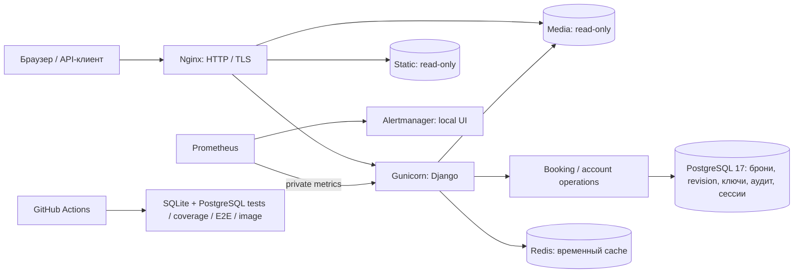

# Готовность к сдаче — 22 ноября 2026

На контрольной точке 22.11.2026 `main` указывал на commit `c9c7f81`; GitHub Actions
run №138 завершился успешно, оба jobs (`tests` и `container`) прошли. В main
включены Grafana dashboard, PostgreSQL connection metrics, проверка Alertmanager
и k6-профиль до 1000 VU. Публичный Render вручную проверен владельцем:
подтверждены 11/11 сценариев приёмки из `DEFECT_REGISTER.md`. Автоматический
CD в Render не настроен.

CI k6 run №138: максимум 1000 VU на 60-секундном плато, 10 568 HTTP-запросов
(10 567 запросов сценария и один предварительный GET /health/), 0 HTTP-ошибок,
10 567/10 567 checks, 61,70 req/s в среднем за полный профиль с ramp-up/down,
p95 3,96 мс и p99 7,28 мс. Это read-only тест изолированного CI-стенда, не
проверка production Render или конкурентного создания бронирований.

## Что уже было и что завершено

До этапа: работающие бронирования, Permissions/Groups, VIP, revision,
идемпотентность, AuditEvent, защита истории/миграций, безопасный профиль и CSV;
358 тестов. Во время инфраструктурной работы: Docker, Gunicorn, Nginx, Redis,
Compose-профили, healthcheck, CI workflow, настройки окружения, 15 новых тестов.
Для сдачи добавлены явные CSV room/date-фильтры, OpenAPI/Swagger, метрики,
Prometheus/Alertmanager, Grafana dashboard, PostgreSQL connection metrics, k6-профиль
на 1000 виртуальных пользователей, ещё 7 тестов, HTTP E2E и покрытие.
В отдельном исправлении каталога 20.11 добавлены ещё 8 регрессионных тестов
порядка, поиска и фильтров. Бизнес-операции, permissions, группы, миграции и
прежние тесты не переписывались.

## Проверенные результаты

| Проверка | Факт |
|---|---|
| Полный набор SQLite в памяти (регрессионный прогон 20.11) | **388 успешно, 72 пропущено**, ошибок нет; пропуски относятся к PostgreSQL-специфичным проверкам |
| Полный набор PostgreSQL 18.7 в изолированном Docker-проекте (регрессия 20.11) | **455 успешно, 5 пропущено**, ошибок нет |
| GitHub Actions run №138: SQLite | **474 теста, 72 пропущено**, ошибок нет |
| GitHub Actions run №138: PostgreSQL 17.12 | **474 теста, 5 пропущено**, ошибок нет |
| Проверки пустой PostgreSQL-базы | **5/5 успешно**; выполнены отдельно до подготовки схемы HTTP-стенда |
| Регрессионные HTTP E2E | **8/8 успешно** |
| Различные автоматические тесты | **474 тестовых случая** в текущем полном наборе; CI run №138 выполнил его на SQLite и PostgreSQL с указанными выше пропусками |
| Критическая логика, statements + branches | **91,84%** по `scripts/check_coverage.py` в GitHub Actions run №138 |
| Весь измеренный код | **90,31%** по сохранённому `reports/coverage-summary.json`; это общий показатель и он не заменяет процент критических модулей |
| GitHub Actions | **Run №138 — success** для commit `c9c7f81`, оба jobs `tests` и `container` завершились успешно. Пройдены SQLite/PostgreSQL-тесты, Ruff, форматирование, Django checks, миграционная проверка, HTTP E2E, Docker, Grafana/Alertmanager и k6 до 1000 VU. CI использует PostgreSQL 17.12; отдельная регрессия 20.11 выполнялась на PostgreSQL 18.7 |
| Django / статические проверки | Django check, Ruff, проверка форматирования, `pip check`, `git diff --check` прошли; `makemigrations --check --dry-run` сообщил `No changes detected` |
| Docker / HTTP | Сборка контейнера успешна; в CI прошли запуск изолированных зависимостей, миграция новой CI-базы, readiness, восстановление после отказа зависимостей, HTTP E2E и PostgreSQL-набор внутри образа |
| Render | Публичный сайт вручную проверен владельцем 20.11.2026: подтверждены 11/11 сценариев приёмки из `DEFECT_REGISTER.md`, включая авторизацию, каталог, расписание, создание/отмену и конфликты бронирований, VIP, CSV, права, API и адаптивность. По сообщению владельца, ошибок не обнаружено |
| Backup/restore | В отдельной тестовой БД `stage563_restore` восстановлены 3 брони, 6 событий и 3 ключа; trigger и exclusion constraint присутствуют. Это тестовое восстановление в новую БД, не проверка аварийного восстановления production |
| Мониторинг | Prometheus, Alertmanager и Grafana dashboard provisioned; PostgreSQL connection metrics добавлены; проверка target/metric/dashboard/alert включена в CI. Внешние уведомления оператору не настроены |

Отчёты измерений: `reports/coverage-summary.json`, `reports/load-100.json`,
`reports/load-200.json`, `reports/load-1000.json`, `reports/monitoring.json`.
Сводка k6 run №138 приложена как GitHub Actions artifact `mrb-k6-load-summary`
к [workflow run №138](https://github.com/nameforreal/MeetingRoomBooking/actions/runs/45071723439).
Production Docker image также публикуется как workflow artifact
`meetingroom-production-image` после успешной сборки; срок хранения — 30 дней.
Покрытие измерено полным
PostgreSQL-набором; `scripts/check_coverage.py` отдельно считает statements +
branches только для явно перечисленных критических модулей. CI run №21 использует
PostgreSQL 17.12, а отдельный регрессионный аудит 20.11 — PostgreSQL 18.7; это
разные окружения и результаты не следует смешивать.

Файлы `reports/load-100.json` и `reports/load-200.json` содержат короткие read-only
прогоны каталога и API. Дополнительно CI run №138 выполнил профиль k6 до 1000 VU:
10 568 HTTP-запросов, 0 HTTP-ошибок, 10 567/10 567 успешных checks, средний RPS
за полный прогон 61,70, p95 3,96 мс, p99 7,28 мс и максимум 52,61 мс. Это не
смешанная нагрузка с записью бронирований; для записи нужен отдельный тест.
Monitoring JSON подтверждает локальный тестовый alert, но не доставку внешнему оператору. Результат backup/restore получен на
изолированной тестовой БД, а не на Neon или Render.

Предыдущая host-попытка PostgreSQL-прогона выявила мутацию словаря settings при
обнаружении container settings; исправлено deepcopy и добавлена регрессия.
После этого PostgreSQL проверялся в изолированных контейнерах. Первый HTTP E2E
отклонял похожий на username пароль фикстуры; генерация исправлена, сам валидатор
регистрации сохранён. Эти неудачные попытки не объявляются успешными.

## Матрица требований преподавателя

| № | Требование | Статус | Подтверждение / граница |
|---|---|---|---|
| 1 | Рабочее Django-приложение | ГОТОВО | HTTP через Nginx/Gunicorn и E2E |
| 2 | Room, Booking, User, Role | ГОТОВО | `Room` и `Booking` — модели приложения, `User` — стандартная модель Django, `Role` — отдельная модель `rooms.Role` с OneToOne-связью к `auth.Group`; permissions продолжают храниться в Django Group |
| 3 | Комнаты и доступность | ГОТОВО | HTML/API и существующие тесты |
| 4 | Создание, отмена, история | ГОТОВО | E2E и регрессии |
| 5 | Запрет двойного бронирования | ГОТОВО | PostgreSQL exclusion constraint и конкурентные тесты |
| 6 | Разграничение прав | ГОТОВО | Permissions/Groups, owner scope, отрицательные тесты |
| 7 | Административное управление | ГОТОВО | Django Admin и собственная панель |
| 8 | VIP-согласование | ГОТОВО | E2E пользователя/сотрудника + регрессии |
| 9 | CSV по дате и комнате | ГОТОВО | Явные room/date_from/date_to, HTML-поля, общая фильтрация и тесты |
| 10 | AuditEvent | ГОТОВО | Атомарный неизменяемый журнал; тесты/backup |
| 11 | Docker app/PostgreSQL/Redis | ГОТОВО | Живой изолированный стек и persistent volumes |
| 12 | CI/CD | ГОТОВО | При push/PR запускаются тесты, Ruff, форматирование и Docker-проверки; production image собирается и доступен как скачиваемый Actions artifact (30 дней). Автодеплой в Render — отдельная необязательная операция и выполняется вручную |
| 13 | Критическое покрытие ≥70% | ГОТОВО | 91,84%, CI gate |
| 14 | Unit / integration / E2E | ГОТОВО | Django-набор и отдельный реальный HTTP E2E; JS/browser E2E не добавлен |
| 15 | Статический анализ | ГОТОВО | Ruff correctness gate, формат новых инфраструктурных файлов |
| 16 | Нагрузка 100–200 RPS | ГОТОВО | Короткие read-only прогоны; не эквивалент длительной смешанной нагрузке |
| 17 | HTTP/errors/latency/DB metrics | ГОТОВО | Counter, histogram, SQL readiness/latency, Redis readiness |
| 18 | Мониторинг и алерты | ГОТОВО | Prometheus/Alertmanager/Grafana, RPS, HTTP errors, p95/p99, PostgreSQL connections и dependency health; CI проверяет dashboard и alert. Внешняя email/webhook-доставка не настроена. Очереди фоновых задач в проекте нет |
| 19 | OpenAPI/Swagger | ГОТОВО | /api/schema/ и /api/docs/; Swagger assets требуют CDN |
| 20 | Архитектурная схема | ГОТОВО | Ниже |
| 21 | Ресурсы: 1000 пользователей/100 RPS | ГОТОВО | Есть расчётная конфигурация 4 vCPU / 8 GB RAM / 50 GB SSD; k6 подтвердил 1000 активных VU в read-only профиле, а отдельные прогоны подтвердили 100 и 200 RPS. Ограничение: это не совместный write-тест и не гарантия производительности production Render |
| 22 | Установка/мониторинг/backup | ГОТОВО | INFRASTRUCTURE.md, этот документ, MIGRATION_SAFETY.md; тестовое восстановление выполнено |
| 23 | План пилота | ГОТОВО | План ниже; реальный пилот ещё не проводился |
| 24 | Дефекты и финальный отчёт | ГОТОВО | Реестр `DEFECT_REGISTER.md`; 11/11 ручных сценариев на публичном Render подтверждены владельцем 20.11.2026, ошибок не обнаружено |
| 25 | IDE и инструменты разработки | ГОТОВО | `.vscode/extensions.json` рекомендует Python, Ruff, Docker, GitLens и YAML; `.vscode/settings.json` включает lint/format on save |
| 26 | Impact analysis для VIP и CSV | ГОТОВО | `IMPACT_ANALYSIS.md` перечисляет затронутые модули, тесты и регрессионные проверки |

Итог по детальной функционально-технической матрице: **26/26 пунктов ГОТОВО**.
Отдельная модель `Role` хранит метаданные ролей и связана с Django Group; разрешения
и членство пользователей продолжают обслуживаться штатной системой Django.
Ограничения по репликации БД, подтверждению SLA 99,9%, рецензии наставника и
пользовательскому пилоту вынесены в [REQUIREMENTS_CHECKLIST.md](REQUIREMENTS_CHECKLIST.md).

## Архитектура



Критические записи сохраняются одной SQL-транзакцией. Redis не хранит историю,
права, блокировки или ключи создания. App/DB/Redis находятся во внутренней сети;
наружу доступен только proxy. Мониторинговые UI привязаны к localhost.

## Состав оборудования и программных средств

Подробная конфигурация сервисов и безопасный порядок запуска приведены в [INFRASTRUCTURE.md](INFRASTRUCTURE.md). Для предварительного пилота принята оценочная конфигурация 4 vCPU, 8 GB RAM и 50 GB SSD; это sizing estimate, а не результат испытания 1000 одновременных пользователей.

| Компонент | ПО / назначение | Плановый бюджет RAM |
|---|---|---:|
| Приложение | Python 3.14.2, Django 6.0.10, Gunicorn; HTML, API и бизнес-операции | до 1,5 GB |
| База данных | PostgreSQL; транзакции, бронирования, permissions, аудит и сессии | около 2 GB |
| Кэш | Redis; только временные некритичные данные | 128 MB |
| Reverse proxy | Nginx в Compose; TLS, HTTP, static/media | 128 MB |
| Мониторинг | Prometheus + Alertmanager, локальный профиль | около 768 MB |
| ОС и файловый cache | Системные процессы и файловый cache | около 1,5 GB |
| Резерв | Пиковое потребление и рост нагрузки | около 2 GB |

Сумма бюджетов RAM ориентировочная и требует проверки на выбранном сервере. CPU выделяется общим ресурсом 4 vCPU; распределение по контейнерам должно быть подтверждено длительным смешанным тестом. Дисковый ориентир 50 GB SSD включает запас под БД, WAL, media и служебные данные. Оценка 7–15 GB/год для БД основана на допущениях 5000 броней/день и 4–8 KB на бронь с ключами, событиями и индексами; фактический рост следует измерять.

### Внешние benchmark references

- [TechEmpower Framework Benchmarks](https://github.com/TechEmpower/FrameworkBenchmarks) — сравнительная методика для web-framework workloads (plaintext, JSON, ORM reads/writes, templates). Проект архивирован 24.03.2026; ссылка используется как методический внешний ориентир, а не как актуальная гарантия производительности Django-приложения.
- [PostgreSQL 17 — pgbench](https://www.postgresql.org/docs/17/pgbench.html) — официальное описание воспроизводимого benchmark-инструмента PostgreSQL, включая concurrent clients, transactions per second и latency. pgbench в этом проекте отдельно не запускался.
- [Django 6.0 — Performance and optimization](https://docs.djangoproject.com/en/6.0/topics/performance/) — официальные рекомендации по оптимизации запросов, кэша, шаблонов и HTTP; это руководство, а не численный benchmark.

Внешние benchmarks не подменяют измерения самого приложения. Собственные результаты и точные ограничения приведены в разделе «Нагрузочный отчёт» ниже.


## Нагрузочный отчёт

Среда: Windows Docker Desktop, Linux-контейнеры; app ограничен 1 CPU / 512 MB,
2 синхронных worker Gunicorn; DB — 1 CPU / 1 GB. Генератор работает на той же машине,
100 потоков, фиксированный темп с ограничением незавершённых запросов. По 15 секунд:

| Цель | Выполнено | Фактический RPS | HTTP errors / dropped | p50 | p95 | p99 |
|---|---:|---:|---:|---:|---:|---:|
| 100 RPS | 1500 | 100,02 | 0 / 0 | 4,99 мс | 27,13 мс | 29,28 мс |
| 200 RPS | 3000 | 199,99 | 0 / 0 | 4,79 мс | 27,28 мс | 29,56 мс |

80% запросов — GET /api/rooms/, 20% — GET /rooms/. Latency включает ожидание
после запланированного момента отправки. Порог скрипта: ≥95% заданного RPS,
нет ошибок/дропов, p95 <1 секунды. Оба прогона прошли. Это не тест большого каталога,
конкурентной записи 200 RPS, удалённой сети, длительной утечки памяти или 1000
одновременно активных HTTP-соединений. Не экстраполировать результаты на них.

### CI: 1000 VU, run №138

Изолированный GitHub Actions runner, Docker Compose test stack; профиль k6 выполнился
до 1000 VU с 60-секундным плато. За весь прогон (~2 мин 50 с, включая ramp-up/down):

| Показатель | Результат |
|---|---:|
| Максимум VU | 1000 |
| HTTP-запросы | 10 568 |
| Неудачные HTTP-запросы | 0 (0,00%) |
| Checks | 10 567 / 10 567 (100%) |
| Средний RPS за весь прогон | 61,70 |
| Средняя задержка | 2,80 мс |
| p95 / p99 | 3,96 / 7,28 мс |
| Максимальная задержка | 52,61 мс |

Средний RPS рассчитан за весь профиль, включая набор и снижение нагрузки; это не
заявление о 100 RPS в среднем за весь прогон. Запросы только GET (`/api/rooms/` и
`/rooms/`), без авторизации и записи бронирований. Проверка подтверждает именно
изолированный CI-стенд, не production Render/Neon. Raw JSON summary сохранён как artifact
`mrb-k6-load-summary` в [workflow run №138](https://github.com/nameforreal/MeetingRoomBooking/actions/runs/45071723439).

### Как читать JSON-отчёт k6

В исходном формате k6 булево значение внутри `thresholds` отвечает на вопрос,
**был ли порог превышен**: `false` означает, что порог пройден, а `true` —
что он нарушен. Поэтому `false` в run №138 не является ошибкой.

У метрики типа Rate `http_req_failed` поля `passes` и `fails` тоже
контринтуитивны: `passes` считает ненулевые значения метрики (неудачные
HTTP-запросы), а `fails` — нулевые значения (успешные запросы). Для фактической
доли ошибок используется поле `value`. Нормализованный файл
`k6-summary-readable.json` переименовывает эти показатели в однозначные
`failed_requests`, `successful_requests` и `thresholds.*.passed`.
CI дополнительно проверяет согласованность raw-флагов с измеренными значениями. В обновлённом CI workflow рядом с raw JSON
создаётся `k6-summary-readable.json`: он явно показывает количество ошибок,
успешных запросов и результат каждого порога.


Воспроизведение только на стенде:

```powershell
python scripts/load_test.py --rps 100 --seconds 15
python scripts/load_test.py --rps 200 --seconds 15
```

## Расчёт ресурсов

1000 вошедших пользователей не равны 1000 одновременно выполняющихся запросов. k6-профиль проверяет именно 1000 виртуальных сессий с паузой 8–12 секунд между GET-запросами.
При 100 RPS средний интервал действий составляет 1000/100 = **10 секунд**.
Для расчётного среднего server response 0,2 с закон Литтла даёт L=100×0,2=**20**
одновременных запросов. Это допущение для запаса, не измеренное среднее.

Начальная конфигурация пилота: **4 vCPU, 8 GB RAM, 50 GB SSD**, отдельные backup.
Бюджет RAM: PostgreSQL 2 GB, приложение до 1,5 GB (например, 4 workers × 5 threads
для 20 запросов), Redis 128 MB, Nginx 128 MB, Prometheus/Alertmanager 768 MB,
ОС/файловый кеш 1,5 GB, запас около 2 GB. Для такой модели workers/threads требуется
отдельная проверка; текущий Docker-профиль намеренно оставлен на проверенных 2 workers.
Соединения БД: до 20 worker threads + миграции/оператор, ориентир лимита 50–80;
не создавать 1000 DB-соединений для 1000 пользовательских сессий.

Пример хранения: 5000 броней/день × 365 ≈ 1,83 млн/год. При условных 4–8 KB на
бронь + ключ + события + индексы: 7–15 GB/год, затем media, WAL и запас. Это оценка,
фактический размер измерять pg_total_relation_size и отдельно media. 50 GB требует
контроля заполнения и расширения, а не удаления истории. Масштабирование до двух
app-инстансов возможно только после пилота и проверки общих media/static/metrics;
в данном этапе оно не реализовано и не заявлено проверенным.

## Мониторинг и эксплуатация

```powershell
$mon = @('--env-file', 'docker/test.env', '-p', 'mrb-infra-test', '-f', 'compose.yaml', '-f', 'compose.test.yaml', '-f', 'compose.monitoring.yaml')
docker compose @mon up -d --wait prometheus alertmanager grafana
python scripts/verify_monitoring.py --project mrb-infra-test
docker compose @mon ps
```

- Grafana: http://127.0.0.1:18091 (admin / isolated-grafana-only — только локальный demo-пароль); Prometheus: http://127.0.0.1:18090; Alertmanager: http://127.0.0.1:18093.
- Scrape app:8000/metrics/ требует bearer token; внешний Nginx возвращает 404.
- Labels не содержат username, ID объекта, query string, токены или ключи создания.
- Gunicorn использует multiprocess aggregation; новый каталог счётчиков создаётся
  на lifecycle master. Перезапуск обнуляет counters, что штатно для rate().
- Ошибки: `sum(rate(mrb_http_requests_total{status=~"5.."}[2m]))`.
- RPS: `sum(rate(mrb_http_requests_total[2m]))`.
- p95: `histogram_quantile(0.95,sum by(le)(rate(mrb_http_duration_seconds_bucket[2m])))`.
- SQL: `mrb_database_up`, `mrb_database_probe_seconds`, `mrb_database_connections`, `mrb_database_active_connections`, `mrb_database_max_connections`; cache: `mrb_cache_up`.

Алерты: ApplicationDown 30с; DatabaseUnavailable/RedisUnavailable 15с;
HTTP 5xx >5% и p95 >1с в течение минуты. Scrape/evaluation каждые 5с.
Оператор сначала смотрит ps/logs, проверяет сеть/готовность DB, не удаляет volumes
и не обходит guard-триггеры. Инструкция восстановления — INFRASTRUCTURE.md.
Redis можно восстановить без восстановления критической истории из cache.

Конфигурация мониторинга — локальная демонстрационная. Перед production заменить
публичный scrape token на отдельный секрет, хранить bearer credentials в закрытом
внешнем конфигурационном файле (не Git) и выбрать внешний email/webhook receiver.
Значения реальных credentials не запрашивались. До этого внешняя доставка **не работает**.
Prometheus хранит 7 дней; Grafana dashboard provisioned из Git. Отдельный postgres_exporter не требуется: счётчики DB connections снимаются Django collector через pg_stat_activity.

## SLA и фактически собранные метрики

| Показатель из задания | Реализация / результат | Статус |
|---|---|---|
| p95 latency ≤ 200 ms | В коротких локальных read-only прогонах p95 составил 27,13 ms при 100 RPS и 27,28 ms при 200 RPS | Цель достигнута только в указанном сценарии |
| Error rate ≤ 0,1% | В тех же прогонах зарегистрировано 0 HTTP errors из 1500 и 3000 запросов | 0% в тестовом окне |
| Availability ≥ 99,9% | Непрерывное наблюдение за длительный период и расчёт uptime не выполнялись | Не подтверждено |
| HTTP requests / errors / latency | Счётчик ответов и histogram задержек с ограниченными labels | Реализовано |
| PostgreSQL / Redis readiness | SQL probe, cache readiness и alerts | Реализовано |
| PostgreSQL connections | Текущие/active connections БД приложения и max_connections сервера через pg_stat_activity | Реализовано; не является метрикой Django connection pool |
| Queue depth | Фоновой очереди задач в проекте нет; пользовательские операции выполняются синхронно | Не применимо |
| Dashboard | Grafana dashboard с HTTP RPS/errors, p95/p99, PostgreSQL connections и health зависимостей | Реализовано в локальном профиле |

SLA 99,9% не следует заявлять как достигнутый: доступность за длительный период не измерялась. Существующие короткие прогоны 100/200 RPS остаются read-only. CI run №138 выполнил k6-профиль до 1000 VU: 10 568 HTTP-запросов, 0 HTTP-ошибок, средний RPS 61,70 за полный профиль с ramp-up/down, p95 3,96 мс и p99 7,28 мс. Этот результат относится к изолированному GitHub Actions runner. Он не подтверждает конкурентные записи бронирований, длительную смешанную нагрузку или производительность Render.


## Сценарий демонстрации (10–15 минут)

1. Показать `docker compose @mon ps`, health, versions и отсутствие host-портов DB/Redis.
2. Зарегистрировать обычного пользователя, открыть комнаты/расписание.
3. Создать обычную бронь; показать отказ пересечения, revision и повтор Idempotency-Key.
4. Создать/перенести VIP-заявку; сотрудником подтвердить через собственную панель.
5. Показать историю AuditEvent и запрет удаления/восстановления отменённой брони.
6. Выбрать комнату и даты, скачать CSV; показать OpenAPI.
7. Запустить `python scripts/e2e_http.py`, показать сохранённое покрытие и load JSON.
8. Показать метрики/алерты, остановку Redis выполнять только тестовым проверочным скриптом.
9. Показать успешный GitHub Actions run №138: jobs tests/container, мониторинг, k6 до 1000 VU и артефакты `mrb-k6-load-summary` / `meetingroom-production-image`. Отдельно пояснить, что Render deploy выполняется вручную.

## План пилотной эксплуатации

Перед сдачей или на отдельно согласованной тестовой площадке: 3–5 тестовых
пользователей и один уполномоченный сотрудник, отдельные данные и согласованная
площадка. Не переносить реальные персональные
данные в тестовый стенд. Роли: обычный пользователь, согласующий сотрудник,
администратор и наблюдатель журнала. Выполнить 10 обычных и 10 VIP-сценариев,
перенос/отмену, повтор отправки, stale forms, архивирование и фильтрованный экспорт.
Проверить mobile/desktop вручную; автоматический HTTP E2E не проверяет JavaScript.

Критерии приёмки: нет потери истории/двойных броней, корректные permissions,
нет HTTP 500 в сценариях, E2E проходит, 100 RPS smoke без ошибок, покрытие ≥70%,
backup восстанавливается в новую БД, оператор видит alarm. Регистрировать дефекты
с шагами, ожидаемым/фактическим результатом и приоритетом. При угрозе данным
остановить запись, сохранить логи/backup и использовать совместимую схему;
не выполнять downgrade непустой истории. Решение go/no-go принимает владелец проекта.

## Комплект документации

- [README.md](README.md) — обзор, запуск и ссылки на материалы.
- [TECHNICAL_SPECIFICATION.md](TECHNICAL_SPECIFICATION.md) — краткое ТЗ: цели, требования, ограничения и приёмка.
- [PROJECT_PLAN.md](PROJECT_PLAN.md) — этапы работ, оценка сроков и риски.
- [REQUIREMENTS_CHECKLIST.md](REQUIREMENTS_CHECKLIST.md) — честная сверка по всем восьми разделам ИСП49.
- [IMPACT_ANALYSIS.md](IMPACT_ANALYSIS.md) — затронутые модули и регрессионные тесты VIP/CSV.
- [ARCHITECTURE.md](ARCHITECTURE.md) — UML component/deployment diagrams, профили Render и Docker Compose, CI pipeline.
- [API_GUIDE.md](API_GUIDE.md) и `/api/schema/` — API / OpenAPI.
- [ROLES.md](ROLES.md) — модель прав и соответствие Role из ИСП49.
- [INFRASTRUCTURE.md](INFRASTRUCTURE.md), [HOSTING_RENDER.md](HOSTING_RENDER.md) — установка и облачный профиль.
- [MIGRATION_SAFETY.md](MIGRATION_SAFETY.md) — миграции и backup/restore.
- [DEFECT_REGISTER.md](DEFECT_REGISTER.md) — ручная приёмка и реестр дефектов.
- [PROJECT_PLAN.md](PROJECT_PLAN.md) — этапы работ, оценка трудозатрат, риски и критерии завершения.
- `reports/` — coverage, load-test и monitoring JSON.

## Реестр оставшихся ограничений

| ID | Приоритет | Ограничение | Следующее действие |
|---|---|---|---|
| D01 | Закрыто | Ручная приёмка основных сценариев на публичном Render завершена 20.11.2026: владелец подтвердил 11/11 проверок, ошибок не обнаружено | Результат зафиксирован в `DEFECT_REGISTER.md`; отдельные ограничения нагрузки, инфраструктуры и браузерной совместимости остаются в D02–D13 |
| D02 | P2 | Непрерывный CD в Render не настроен; Auto Deploy выключен. CI уже прикладывает собранный production Docker image как Actions artifact | Для автоматического облачного deploy потребуется отдельное решение владельца и настройка Render Deploy Hook/Auto Deploy |
| D03 | Закрыто | Добавлена отдельная модель `rooms.Role` с таблицей `rooms_role`, кодом и описанием; каждая запись связана с одной `auth.Group`. Команда `setup_roles` создаёт метаданные, права по-прежнему проверяются через Django Group/Permission | Миграция `0010_role_model` переносит метаданные существующих групп; downgrade сначала проверяет защищённую бизнес-историю, затем запрещает удаление заполненных Role records |
| D04 | Закрыто в рамках ИСП49 | Alertmanager настроен; тестовое предупреждение `RedisUnavailable` получено локальным Alertmanager и проверено в CI | Внешняя email/webhook-доставка не настроена и не требуется явным критерием задания |
| D05 | P2 | CI run №138 подтвердил 1000 VU на 60-секундном плато: 10 568 HTTP-запросов, 0 HTTP-ошибок, 61,70 req/s за весь профиль, p95 3,96 мс; host-specific CPU/RAM и запись бронирований не измерялись | При необходимости повторить профиль на собственной изолированной машине для фиксации CPU/RAM; конкурентные записи бронирований тестировать отдельно |
| D06 | P2 | API-списки без пагинации, собственный admin-список ограничен 300 строками | Не скрывать ограничение; отдельная задача при росте объёма данных |
| D07 | P2 | Swagger UI требует CDN; browser/JS E2E отсутствует | Проверить в браузере на машине преподавателя; OpenAPI JSON доступен отдельно |
| D08 | P2 | Bootstrap DB-role владеет БД, demo monitoring не production-hardening | Отдельные runtime/migration роли и защищённый monitoring перед production |
| D09 | P3 | Предупреждения `naive datetime` в тесте стандартного Admin date-фильтра | Тест проходит; проверить влияние при иной временной зоне, если это важно для эксплуатации |
| D10 | P2 | Полноценный пользовательский пилот с 3–5 участниками не проводился | Провести короткую приёмку по плану выше, если есть время и согласованная площадка |
| D11 | P2 | Safari, Firefox и физические мобильные устройства отдельно не проверялись | Выполнить ручную кросс-браузерную проверку, если они входят в критерии приёмки |
| D12 | P2 | Рецензия документации наставником/одногруппником не зафиксирована | Попросить проверяющего просмотреть комплект и записать замечания/подтверждение |
| D13 | Закрыто | Grafana dashboard и PostgreSQL connection metrics добавлены в локальный monitoring profile; CI проверяет provisioning и наличие метрик | Внешнюю email/webhook-доставку настраивать только при отдельном требовании; не публиковать monitoring UI |

Проект готов к функциональной демонстрации на локальном стенде; публичный Render-сайт
также доступен, но это не означает полной production-готовности. Перед окончательной
сдачей остаются фактическая рецензия документации наставником/одногруппником и,
если есть время, короткий пилот с 3–5 участниками. Ручная проверка владельцем 11/11
сценариев на Render уже зафиксирована в `DEFECT_REGISTER.md`. Автоматический CD в
Render остаётся отдельным решением; production Docker image доступен как artifact CI.
Исторический журнал в `HOSTING_RENDER.md` заканчивается до фактического ручного
развёртывания; текущий статус Render зафиксирован в этом документе.
