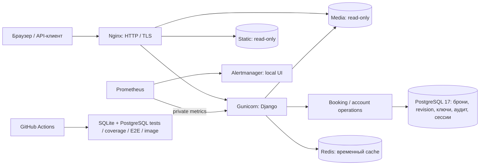

# Готовность к сдаче — 18 ноября 2026

Контрольная точка до изменений: `4617d3e`. Изменения не закоммичены и не отправлены
на GitHub. Срок сдачи: 20 ноября 2026. Ниже отделены измеренные результаты от
планов и эксплуатационных допущений.

## Что уже было и что завершено

До этапа: работающие бронирования, Permissions/Groups, VIP, revision,
идемпотентность, AuditEvent, защита истории/миграций, безопасный профиль и CSV;
358 тестов. Во время инфраструктурной работы: Docker, Gunicorn, Nginx, Redis,
Compose-профили, healthcheck, CI workflow, настройки окружения, 15 новых тестов.
Для сдачи добавлены явные CSV room/date-фильтры, OpenAPI/Swagger, метрики,
Prometheus/Alertmanager, ещё 7 тестов, HTTP E2E, покрытие и нагрузочный сценарий.
Бизнес-операции, permissions, группы, миграции и прежние тесты не переписывались.

## Проверенные результаты

| Проверка | Факт |
|---|---|
| PostgreSQL 17.12 внутри mrb-infra-test | **380/380**, 22,261 с, без пропусков |
| SQLite в памяти | **324 успешно**, 56 ожидаемых PostgreSQL-пропусков; всего 380 |
| Новые регрессионные тесты | 22; все прежние 358 сохранены |
| Критическая логика, statements + branches | **91,47%** по scripts/check_coverage.py |
| Весь измеренный код | **90,31%**, исключения явно заданы в .coveragerc |
| Django check / production deploy-check | Без ошибок и предупреждений |
| makemigrations --check --dry-run | No changes detected; новых миграций нет |
| Ruff / формат новых файлов / pip check | Успешно |
| Docker | Чистая сборка прошла; последующие изменения проверены кешируемой сборкой |
| SQL / Redis / HTTP / static | Проверены живым HTTP и readiness |
| Redis outage | SQL-бронирование, история и idempotent replay работают |
| PostgreSQL stop/start | HTTP 503 во время отказа, автоматическое восстановление и сохранность снимков |
| Повтор Compose stop/up | Данные и история сохранены, контейнеры/тома не удалены |
| HTTP E2E | Регистрация, login/CSRF, создание, конфликт, replay, revision, VIP, права, CSV, отмена, история |
| Мониторинг | Scrape up; реальный RedisUnavailable получен Alertmanager |
| Backup/restore | pg_dump/pg_restore в новую stage563_restore; 3 брони, 6 событий, 3 ключа совпали; trigger и exclusion constraint присутствуют |
| GitHub Actions | YAML и команды проверены локально; **реального GitHub run ещё нет** |

Отчёты измерений: `reports/coverage-summary.json`, `reports/load-100.json`,
`reports/load-200.json`, `reports/monitoring.json`. Покрытие измерено полной
PostgreSQL-регрессией, не E2E и не нагрузкой. Критические модули: models,
booking_operations/idempotency/rules, account_operations, audit, retention,
permissions, querysets. Миграции исключены из процента, но покрыты отдельными
реальными reverse/DDL/concurrency тестами.

Первая host-попытка PostgreSQL-прогона выявила мутацию словаря settings при
обнаружении container settings; исправлено deepcopy и добавлена регрессия.
После этого PostgreSQL проверялся исключительно внутри mrb-infra-test.
Первый HTTP E2E отклонял похожий на username пароль фикстуры; генерация исправлена,
сам валидатор регистрации сохранён. Эти неудачные попытки не объявляются успешными.

## Матрица требований преподавателя

| № | Требование | Статус | Подтверждение / граница |
|---|---|---|---|
| 1 | Рабочее Django-приложение | ГОТОВО | HTTP через Nginx/Gunicorn и E2E |
| 2 | Room, Booking, User, Role | ЧАСТИЧНО | Первые три модели есть; роль реализована стандартной Group, отдельного класса Role нет. Согласовать терминологию с преподавателем, не дублировать Groups |
| 3 | Комнаты и доступность | ГОТОВО | HTML/API и существующие тесты |
| 4 | Создание, отмена, история | ГОТОВО | E2E и регрессии |
| 5 | Запрет двойного бронирования | ГОТОВО | PostgreSQL exclusion constraint и конкурентные тесты |
| 6 | Разграничение прав | ГОТОВО | Permissions/Groups, owner scope, отрицательные тесты |
| 7 | Административное управление | ГОТОВО | Django Admin и собственная панель |
| 8 | VIP-согласование | ГОТОВО | E2E пользователя/сотрудника + регрессии |
| 9 | CSV по дате и комнате | ГОТОВО | Явные room/date_from/date_to, HTML-поля, общая фильтрация и тесты |
| 10 | AuditEvent | ГОТОВО | Атомарный неизменяемый журнал; тесты/backup |
| 11 | Docker app/PostgreSQL/Redis | ГОТОВО | Живой изолированный стек и persistent volumes |
| 12 | CI/CD | ЧАСТИЧНО | Push/PR workflow, проверки, сборка; GitHub run/publish/server deploy не выполнены |
| 13 | Критическое покрытие ≥70% | ГОТОВО | 91,47%, CI gate |
| 14 | Unit / integration / E2E | ГОТОВО | Django-набор и отдельный реальный HTTP E2E; JS/browser E2E не добавлен |
| 15 | Статический анализ | ГОТОВО | Ruff correctness gate, формат новых инфраструктурных файлов |
| 16 | Нагрузка 100–200 RPS | ГОТОВО | Короткие read-only прогоны; не эквивалент длительной смешанной нагрузке |
| 17 | HTTP/errors/latency/DB metrics | ГОТОВО | Counter, histogram, SQL readiness/latency, Redis readiness |
| 18 | Мониторинг и алерты | ЧАСТИЧНО | Prometheus/Alertmanager и живой alert проверены; доставка внешнему оператору не настроена |
| 19 | OpenAPI/Swagger | ГОТОВО | /api/schema/ и /api/docs/; Swagger assets требуют CDN |
| 20 | Архитектурная схема | ГОТОВО | Ниже |
| 21 | Ресурсы: 1000 пользователей/100 RPS | ГОТОВО | Расчёт ниже; одновременные 1000 сессий нагрузкой не доказаны |
| 22 | Установка/мониторинг/backup | ГОТОВО | INFRASTRUCTURE.md, этот документ, MIGRATION_SAFETY.md; тестовое восстановление выполнено |
| 23 | План пилота | ГОТОВО | План ниже; реальный пилот ещё не проводился |
| 24 | Дефекты и финальный отчёт | ГОТОВО | Этот документ и измеренные артефакты |

Итог: **21 ГОТОВО, 3 ЧАСТИЧНО**. Отсутствие полностью пустых пунктов не означает
полную production-готовность: частичные пункты и ограничения измерений существенны.

## Архитектура



Критические записи сохраняются одной SQL-транзакцией. Redis не хранит историю,
права, блокировки или ключи создания. App/DB/Redis находятся во внутренней сети;
наружу доступен только proxy. Мониторинговые UI привязаны к localhost.

## Нагрузочный отчёт

Среда: Windows Docker Desktop, Linux-контейнеры; app ограничен 1 CPU / 512 MB,
2 синхронных worker Gunicorn; DB — 1 CPU / 1 GB. Генератор работает на той же машине,
100 потоков, фиксированный темп с ограничением незавершённых запросов. По 15 секунд:

| Цель | Выполнено | Фактический RPS | HTTP errors / dropped | p50 | p95 | p99 |
|---|---:|---:|---:|---:|---:|---:|
| 100 RPS | 1500 | 100,02 | 0 / 0 | 4,99 мс | 27,13 мс | 29,28 мс |
| 200 RPS | 3000 | 199,99 | 0 / 0 | 4,79 мс | 27,28 мс | 29,56 мс |

80% запросов — GET /api/rooms/, 20% — GET /rooms/. Latency включает ожидание
после запланированного момента отправки. Порог скрипта: ≥95% заданного RPS,
нет ошибок/дропов, p95 <1 секунды. Оба прогона прошли. Это не тест большого каталога,
конкурентной записи 200 RPS, удалённой сети, длительной утечки памяти или 1000
одновременно активных HTTP-соединений. Не экстраполировать результаты на них.

Воспроизведение только на стенде:

```powershell
python scripts/load_test.py --rps 100 --seconds 15
python scripts/load_test.py --rps 200 --seconds 15
```

## Расчёт ресурсов

1000 вошедших пользователей не равны 1000 одновременно выполняющихся запросов.
При 100 RPS средний интервал действий составляет 1000/100 = **10 секунд**.
Для расчётного среднего server response 0,2 с закон Литтла даёт L=100×0,2=**20**
одновременных запросов. Это допущение для запаса, не измеренное среднее.

Начальная конфигурация пилота: **4 vCPU, 8 GB RAM, 50 GB SSD**, отдельные backup.
Бюджет RAM: PostgreSQL 2 GB, приложение до 1,5 GB (например, 4 workers × 5 threads
для 20 запросов), Redis 128 MB, Nginx 128 MB, Prometheus/Alertmanager 768 MB,
ОС/файловый кеш 1,5 GB, запас около 2 GB. Для такой модели workers/threads требуется
отдельная проверка; текущий Docker-профиль намеренно оставлен на проверенных 2 workers.
Соединения БД: до 20 worker threads + миграции/оператор, ориентир лимита 50–80;
не создавать 1000 DB-соединений для 1000 пользовательских сессий.

Пример хранения: 5000 броней/день × 365 ≈ 1,83 млн/год. При условных 4–8 KB на
бронь + ключ + события + индексы: 7–15 GB/год, затем media, WAL и запас. Это оценка,
фактический размер измерять pg_total_relation_size и отдельно media. 50 GB требует
контроля заполнения и расширения, а не удаления истории. Масштабирование до двух
app-инстансов возможно только после пилота и проверки общих media/static/metrics;
в данном этапе оно не реализовано и не заявлено проверенным.

## Мониторинг и эксплуатация

```powershell
$mon = @('--env-file', 'docker/test.env', '-p', 'mrb-infra-test', '-f', 'compose.yaml', '-f', 'compose.test.yaml', '-f', 'compose.monitoring.yaml')
docker compose @mon up -d --wait
python scripts/verify_monitoring.py
docker compose @mon ps
```

- Prometheus: http://127.0.0.1:18090; Alertmanager: http://127.0.0.1:18093.
- Scrape app:8000/metrics/ требует bearer token; внешний Nginx возвращает 404.
- Labels не содержат username, ID объекта, query string, токены или ключи создания.
- Gunicorn использует multiprocess aggregation; новый каталог счётчиков создаётся
  на lifecycle master. Перезапуск обнуляет counters, что штатно для rate().
- Ошибки: `sum(rate(mrb_http_requests_total{status=~"5.."}[2m]))`.
- RPS: `sum(rate(mrb_http_requests_total[2m]))`.
- p95: `histogram_quantile(0.95,sum by(le)(rate(mrb_http_duration_seconds_bucket[2m])))`.
- SQL: `mrb_database_up`, `mrb_database_probe_seconds`; cache: `mrb_cache_up`.

Алерты: ApplicationDown 30с; DatabaseUnavailable/RedisUnavailable 15с;
HTTP 5xx >5% и p95 >1с в течение минуты. Scrape/evaluation каждые 5с.
Оператор сначала смотрит ps/logs, проверяет сеть/готовность DB, не удаляет volumes
и не обходит guard-триггеры. Инструкция восстановления — INFRASTRUCTURE.md.
Redis можно восстановить без восстановления критической истории из cache.

Конфигурация мониторинга — локальная демонстрационная. Перед production заменить
публичный scrape token на отдельный секрет, хранить bearer credentials в закрытом
внешнем конфигурационном файле (не Git) и выбрать внешний email/webhook receiver.
Значения реальных credentials не запрашивались. До этого внешняя доставка **не работает**.
Prometheus хранит 7 дней; Grafana и сложные exporter-стэки не добавлялись.

## Сценарий демонстрации (10–15 минут)

1. Показать `docker compose @mon ps`, health, versions и отсутствие host-портов DB/Redis.
2. Зарегистрировать обычного пользователя, открыть комнаты/расписание.
3. Создать обычную бронь; показать отказ пересечения, revision и повтор Idempotency-Key.
4. Создать/перенести VIP-заявку; сотрудником подтвердить через собственную панель.
5. Показать историю AuditEvent и запрет удаления/восстановления отменённой брони.
6. Выбрать комнату и даты, скачать CSV; показать OpenAPI.
7. Запустить `python scripts/e2e_http.py`, показать сохранённое покрытие и load JSON.
8. Показать метрики/алерты, остановку Redis выполнять только тестовым проверочным скриптом.
9. Показать CI YAML и честно отделить локальные проверки от ещё не выполненного GitHub run.

## План пилотной эксплуатации

До 20 ноября: 3–5 тестовых пользователей и один уполномоченный сотрудник,
отдельные данные и согласованная площадка. Не переносить реальные персональные
данные в тестовый стенд. Роли: обычный пользователь, согласующий сотрудник,
администратор и наблюдатель журнала. Выполнить 10 обычных и 10 VIP-сценариев,
перенос/отмену, повтор отправки, stale forms, архивирование и фильтрованный экспорт.
Проверить mobile/desktop вручную; автоматический HTTP E2E не проверяет JavaScript.

Критерии приёмки: нет потери истории/двойных броней, корректные permissions,
нет HTTP 500 в сценариях, E2E проходит, 100 RPS smoke без ошибок, покрытие ≥70%,
backup восстанавливается в новую БД, оператор видит alarm. Регистрировать дефекты
с шагами, ожидаемым/фактическим результатом и приоритетом. При угрозе данным
остановить запись, сохранить логи/backup и использовать совместимую схему;
не выполнять downgrade непустой истории. Решение go/no-go принимает владелец проекта.

## Реестр оставшихся ограничений

| ID | Приоритет | Ограничение | Следующее действие |
|---|---|---|---|
| D01 | P1 для внешнего выпуска | GitHub Actions ещё не запускался на GitHub | Владелец делает согласованный commit/push, проверяет оба jobs и branch protection |
| D02 | P1 для внешнего выпуска | Нет согласованного сервера/TLS/автодеплоя | Подготовить площадку, сертификат, credentials; не объявлять CD выполненным |
| D03 | P2 | Роль — Group, а не отдельная Role | Подтвердить эквивалентность формальному заданию преподавателя |
| D04 | P2 | Внешние уведомления не настроены | Выбрать receiver и проверить доставку оператору |
| D05 | P2 | Нагрузка короткая/read-only; 1000 пользователей не испытаны | Длительный смешанный тест на пилотной площадке |
| D06 | P2 | API-списки без пагинации, собственный admin-список ограничен 300 строками | Не скрывать ограничение; отдельная последующая задача при росте данных |
| D07 | P2 | Swagger UI требует CDN; browser/JS E2E отсутствует | Проверить браузером на машине преподавателя; JSON доступен автономно |
| D08 | P2 | Bootstrap DB-role владеет БД, demo monitoring не production-hardening | Отдельные runtime/migration роли и защищённый monitoring перед внешним выпуском |
| D09 | P3 | Два warning о naive datetime в тесте стандартного Admin date-фильтра | Не влияет на прохождение; в текущем UTC даты совпадают, иной TZ проверить отдельно |

Готово к функциональной демонстрации на локальном стенде. Полная внешняя
production-готовность не заявляется. Перед окончательной сдачей нужны просмотр
владельцем diff, разрешённый commit/push, реальный GitHub run, подтверждение Group/Role
и ручная проверка демонстрации в браузере. Ни commit, ни push этим этапом не выполнялись.
